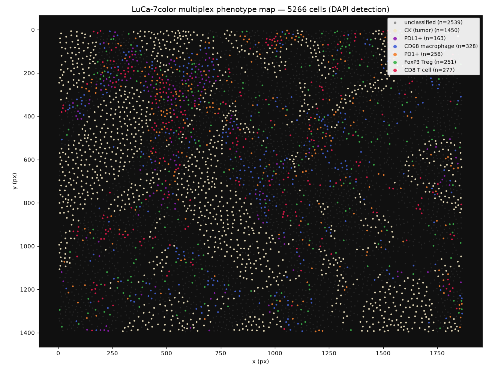

# Expected result — Workflow 2

- **Detection:** `qupath_run_cell_detection` reports `detectionsBefore: 0` → `detectionsAfter: 5266`
  (`added: 5266`). The QuPath run log independently confirms *"5266 nuclei detected"* (~3.3 s).
- **Verification:** `qupath_get_detection_summary` returns `totalDetections: 5266`.
- **Export:** `qupath_export_measurements` writes a CSV of **5266 rows × 134 columns** and returns its
  path.

## About the sample CSV

[`measurements_sample.csv`](measurements_sample.csv) is a **representative excerpt** — the real
structural QuPath columns (centroid, nucleus/cell area & shape) plus four of the seven intensity
channels, with five illustrative rows. The full table (all 7 channels' nucleus/cell/cytoplasm
statistics = 134 columns, one row per cell = 5266 rows) is produced by the tool at run time; only an
abridged version is committed here to keep the repository small.

## Success criteria

- [x] Detection count strictly increases (0 → 5266).
- [x] The verification call agrees with the detection tool's reported count.
- [x] A CSV file is written, parses as CSV, and has the expected columns (centroid, shape, per-channel
      intensities).
- [x] Only objects **inside the selected `Tumor` annotation** are created — nothing else in the
      project changes.

